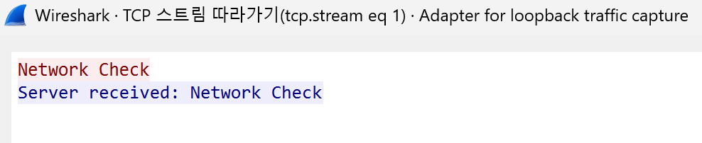
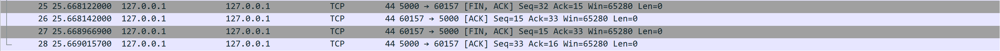
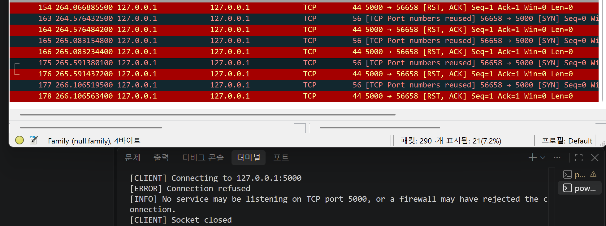
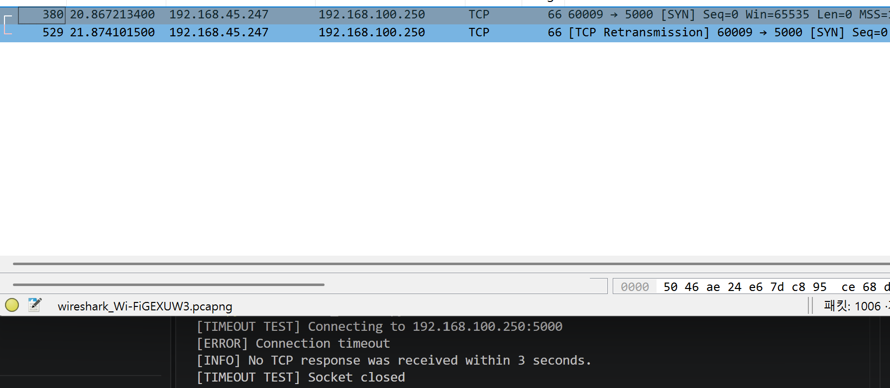

# TCP Network Troubleshooting Lab

## 1. Project Overview

이 프로젝트는 Python Socket으로 간단한 TCP Client/Server를 구현하고, 같은 통신을 Wireshark 패킷 캡처와 대조하는 실습이다. 정상 연결에서는 3-Way Handshake, 데이터 송수신, 연결 종료를 관찰한다. 이어서 서버를 중지해 Connection Refused를 재현하고, 별도 클라이언트로 Connection Timeout을 시도한다.

핵심 흐름은 구현 → 패킷 관찰 → 장애 재현 → 원인 분석이다. 콘솔의 예외 메시지만 읽는 데서 끝내지 않고, SYN·ACK·RST·FIN과 재전송 여부를 함께 살펴본다. 네트워크 엔지니어가 장애를 좁혀 갈 때 필요한 프로세스, 포트, 경로, 패킷의 관계를 작은 환경에서 연습할 수 있다.

> 이 저장소에는 캡처 이미지가 포함되지 않는다. `images/`의 다섯 PNG 경로는 직접 실습한 Wireshark 화면을 추가하기 위한 자리다. 캡처에서 실제로 보이지 않은 패킷을 결과로 기록하지 않는다.

## 2. Architecture

```text
+-----------------------+
|     Python Client     |
| 127.0.0.1:임시 포트    |
+-----------+-----------+
            |
            | TCP / 목적지 포트 5000
            v
+-----------------------+
|     Python Server     |
|    127.0.0.1:5000     |
+-----------------------+

               Wireshark
  정상/거절: Loopback 캡처 인터페이스
  원격 IP Timeout 시도: 실제 송신 인터페이스
```

클라이언트의 출발지 포트는 운영체제가 임시로 정한다. 서버는 한 번의 연결을 처리하고 종료하므로 다음 정상 통신 실험 때 다시 실행한다. `127.0.0.1`은 자기 컴퓨터를 가리키며, 이 실습의 정상 통신은 외부 네트워크 장비를 지나지 않는다.

## 3. Tech Stack

| 항목 | 역할 |
|---|---|
| Python 3 | TCP 서버와 클라이언트 실행 |
| Python `socket` | IPv4 `AF_INET`, TCP `SOCK_STREAM` 소켓 생성 |
| TCP/IP | 연결 수립·데이터 전달·종료 및 실패 상황 분석 |
| Wireshark + Npcap | Windows에서 패킷 캡처와 TCP Stream 확인 |
| Windows 10/11 + VSCode | 기본 실습 환경 및 터미널 |

Python 외부 패키지는 필요하지 않다. Wireshark와 Npcap은 별도로 설치하는 데스크톱 도구이며 `pip` 패키지가 아니다.

## 4. Project Structure

```text
tcp-network-troubleshooting-lab/
├── server.py
├── client.py
├── timeout_client.py
├── README.md
├── requirements.txt
├── .gitignore
└── images/
    └── .gitkeep
```

실습을 마친 뒤 `images/`에 `tcp_handshake.png`, `tcp_data.png`, `tcp_termination.png`, `connection_refused.png`, `connection_timeout.png`를 추가한다.

## 5. How to Run

1. Windows 10/11에 Python 3, VSCode, Wireshark를 준비한다. Wireshark 설치 시 Npcap도 설치되어 있어야 Loopback 캡처가 가능하다.
2. VSCode에서 `tcp-network-troubleshooting-lab` 폴더를 열고 Terminal → New Terminal을 두 번 실행한다. 두 터미널 모두 현재 위치가 프로젝트 폴더인지 확인한다.
3. 정상 통신을 패킷으로 볼 때는 6절의 Loopback 캡처를 먼저 시작한다.
4. Terminal 1에서 서버를 실행한다.

   ```powershell
   python server.py
   ```

   예상 시작 메시지: `[SERVER] Listening on 127.0.0.1:5000`

5. Terminal 2에서 클라이언트를 실행한다.

   ```powershell
   python client.py
   ```

   클라이언트에서 `[CLIENT] Connected`, `[CLIENT] Sent: Hello Webzen Network`, `[CLIENT] Received: Server received: Hello Webzen Network`를 확인한다. 서버에서는 연결된 클라이언트의 IP/포트, 받은 메시지, 응답 전송, 연결 종료가 출력된다.
6. 서버는 클라이언트 한 번을 처리한 뒤 종료한다. 정상 통신을 다시 캡처하려면 Terminal 1에서 `python server.py`를 재실행한다.

`python` 명령이 인식되지 않는 Windows 환경에서는 Python 설치와 PATH를 확인한다. Python Launcher가 있다면 위 명령의 `python`을 `py -3`으로 바꿔 실행할 수 있다. `requirements.txt`에는 설치할 외부 Python 패키지가 없다.

코드 문법만 먼저 확인하려면 프로젝트 폴더에서 다음을 실행한다.

```powershell
python -m py_compile server.py client.py timeout_client.py
```

## 6. Wireshark Setup

### 정상 통신과 Connection Refused: Loopback 캡처

1. Wireshark를 실행하고 인터페이스 목록에서 Adapter for loopback traffic capture를 선택한다. 환경에 따라 Loopback Traffic Capture Adapter, `NPF_Loopback`, 또는 구형 설치의 Npcap Loopback Adapter처럼 보일 수 있다. 일반 Ethernet/Wi-Fi를 선택하면 `127.0.0.1` 트래픽이 보이지 않을 수 있다.
2. 캡처를 시작한 뒤 Wireshark 상단 Display Filter*입력란에 다음을 넣고 Enter를 누른다.

   ```text
   tcp.port == 5000
   ```

   이는 출발지 또는 목적지 TCP 포트가 5000인 패킷을 보여주는 표시 필터다. 캡처 필터 입력란에 넣는 문법과 다르다.
3. 서버와 클라이언트를 순서대로 실행한다. 패킷 목록의 `Source`, `Destination`, `Info` 열과 패킷 상세의 `Transmission Control Protocol → Flags`, 포트 번호를 비교한다. 클라이언트 포트는 매 실행마다 달라질 수 있다.
4. 한 실험이 끝나면 캡처를 멈추고 화면을 저장한다. 새 실험은 새 캡처로 시작하거나, 포트가 같은 다른 연결과 섞이지 않도록 TCP Stream을 구분한다.

Npcap 기반 Windows Loopback 캡처와 인터페이스 이름은 [Wireshark Loopback 안내](https://wiki.wireshark.org/CaptureSetup/Loopback)를 참고한다. Wireshark의 [표시 필터 설명](https://www.wireshark.org/docs/wsug_html_chunked/ChWorkDisplayFilterSection)도 확인할 수 있다.

### Connection Timeout 시도: 송신 인터페이스

`timeout_client.py`의 기본 목적지는 `192.168.100.250`이므로 Loopback 대상이 아니다. 이 사례는 Windows에서 그 주소로 나가는 경로의 Ethernet 또는 Wi-Fi 인터페이스를 선택해 캡처한다. 목적지에 대한 경로가 없거나 같은 네트워크에서 ARP 단계가 실패하면 TCP SYN 자체가 안 보일 수 있다. 그때는 `tcp.port == 5000` 표시 필터를 잠시 지우고 ARP/ICMP 등과 Windows 라우팅 상태를 확인한다.

## 7. TCP 3-Way Handshake Analysis

재현: Loopback 캡처를 시작하고 `python server.py` → `python client.py` 순서로 실행한다. 첫 연결의 클라이언트 임시 포트와 서버 포트 5000을 기준으로 아래 패킷을 찾는다.

```text
Client (127.0.0.1:임시 포트)       Server (127.0.0.1:5000)
               SYN ---------------------->
                   <---------------- SYN, ACK
               ACK ---------------------->
                    TCP Connection Established
```

| 순서 | 방향 | 관찰할 Flag | 의미 |
|---|---|---|---|
| 1 | Client → Server | `SYN` | TCP 연결을 요청하고 자신의 초기 순서 번호를 알린다. |
| 2 | Server → Client | `SYN, ACK` | 연결 요청을 수락하고 클라이언트의 SYN을 확인한다. |
| 3 | Client → Server | `ACK` | 서버의 SYN을 확인하여 연결 수립을 마무리한다. |

Wireshark에서 세 패킷의 출발지·목적지 포트가 왕복 방향으로 바뀌는지 확인한다. 여기서 `connect()` 성공은 이 TCP 연결 수립과 대응한다. `ACK`는 이미 받은 순서 번호를 확인한다는 뜻이며, 데이터 패킷에도 함께 표시될 수 있다.

캡처할 화면: 세 패킷의 `Info` 열에서 `SYN`, `SYN, ACK`, `ACK`가 순서대로 보이게 한다. 패킷 상세에서 TCP 포트와 Flags를 펼쳐 두면 분석 근거가 명확하다.


## 8. TCP Data Transmission Analysis

Handshake 뒤 클라이언트는 `Hello Webzen Network`를 UTF-8 바이트로 보내고, 서버는 `Server received: Hello Webzen Network`를 보낸다. Wireshark에서 해당 연결의 데이터 길이가 0보다 큰 TCP 패킷을 선택해 `TCP payload` 또는 하단 `Packet Bytes`를 본다. `Info`에 `PSH, ACK`가 보일 수 있지만, 모든 데이터 패킷에 PSH가 반드시 붙는 것은 아니다.

패킷 하나를 우클릭해 Follow → TCP Stream을 선택하면 두 방향의 애플리케이션 데이터를 한 화면에서 확인할 수 있다. Wireshark는 해당 연결을 선택하는 필터를 자동 적용할 수 있으므로, 다음 사례를 볼 때는 기존 표시 필터로 돌아왔는지 확인한다. [Wireshark Follow Stream 안내](https://www.wireshark.org/docs/wsug_html_chunked/ChapterAdvFollowStreamSection)를 참고할 수 있다.

```text
Client → Server: Network Check
Server → Client: Server received: Network Check
```

이 텍스트는 HTTP 메시지가 아니라 직접 만든 TCP 애플리케이션 데이터다. TCP는 바이트 스트림이므로 일반적으로 `send()` 한 번이 캡처의 패킷 하나 또는 상대의 `recv()` 한 번과 항상 일치하지는 않는다. 이 랩은 짧은 메시지 한 번을 주고받는 구성이다.

캡처할 화면: Follow TCP Stream 창에서 요청과 응답 텍스트가 모두 읽히도록 한다. 가능하면 원래 패킷 목록의 데이터 패킷도 함께 확인한다.



## 9. TCP Connection Termination

요청과 응답이 끝나고 양쪽 소켓이 닫히면 TCP 종료를 확인할 수 있다. 어느 쪽이 먼저 닫는지는 실행 시점에 따라 달라진다. 다음은 클라이언트가 먼저 닫는 경우의 개념도다.

```text
Client                         Server
  FIN, ACK --------------------->
           <-------------------- ACK
           <-------------------- FIN, ACK
  ACK -------------------------->
             Connection Closed
```

FIN은 한쪽에서 더 보낼 데이터가 없다는 뜻이고, ACK는 상대의 FIN을 확인한다. 양방향 종료를 설명할 때 이를 TCP 4-Way Handshake라고 부른다. 다만 이 프로젝트의 서버는 한 번 응답한 뒤 종료하므로 서버가 먼저 FIN을 보낼 수도 있다. 운영체제와 소켓 종료 시점에 따라 ACK가 다른 패킷과 합쳐지거나 패킷 순서가 다르게 보일 수 있으니, 실제 캡처에서 어느 쪽이 FIN을 먼저 보냈는지 따라가며 설명한다.

캡처할 화면:같은 TCP 연결의 마지막 부분에서 FIN/ACK 교환과 출발지·목적지 포트를 보이게 한다. 패킷 네 개가 정확히 분리되어야 한다고 가정하지 않는다.



## 10. Troubleshooting Case 1 - Connection Refused

장애 재현:*서버 프로세스가 완전히 종료된 상태를 확인한다. 이 서버는 한 클라이언트 처리 후 자동 종료하므로 정상 실습 직후라면 이미 종료되어 있다. Loopback에서 새 캡처를 시작하고 다음을 실행한다.

```powershell
python client.py
```

클라이언트에는 다음처럼 출력된다.

```text
[ERROR] Connection refused
[INFO] No service may be listening on TCP port 5000, or a firewall may have rejected the connection.
[CLIENT] Socket closed
```

Loopback에서 흔히 보이는 패킷 흐름은 `Client → SYN`, `상대 TCP 스택 → RST, ACK`다. RST는 그 연결 요청을 거절하거나 초기화했음을 뜻한다. 여기서는 같은 컴퓨터의 TCP 스택이 포트 5000에 Listener가 없다는 사실을 알고 응답한 것으로 해석할 수 있다. 따라서 패킷이 전혀 전달되지 않는 상황과는 다르다.

하지만 `RST = 서버 프로그램이 반드시 꺼짐`은 아니다. Firewall Reject, 보안 장비 또는 다른 정책도 RST를 만들 수 있다. 원격 장애라면 RST의 출발지, 서버의 Listener 상태, 방화벽 정책을 함께 확인해야 한다. 콘솔의 안내 문구도 이 로컬 실습의 전형적인 설명이며 모든 네트워크에서 단독 증거로 삼지 않는다.

캡처할 화면: 포트 5000으로 보낸 SYN과 그에 대한 RST/ACK가 함께 보이고, 패킷 상세의 TCP Flags가 드러나게 한다.



## 11. Troubleshooting Case 2 - Connection Timeout

장애 재현 시도: `timeout_client.py` 상단의 `HOST`, `PORT`, `TIMEOUT`을 확인한다. 기본값은 예시로 `HOST = "192.168.100.250"`, `PORT = 5000`, `TIMEOUT = 3`이다. 이 주소가 반드시 Timeout을 만드는 것은 아니다. 해당 네트워크로 나가는 Ethernet/Wi-Fi 인터페이스에서 새 캡처를 시작한 후 실행한다.

```powershell
python timeout_client.py
```

실제로 지정 시간 동안 TCP 연결 결과를 받지 못하면 다음처럼 출력된다.

```text
[ERROR] Connection timeout
[INFO] No TCP response was received within 3 seconds.
```

경로상 SYN이 전송되고 응답이 없는 경우 `SYN → 응답 없음 → SYN 재전송 → ...`을 볼 수 있다. Wireshark가 재전송을 `TCP Retransmission`으로 표시할 수 있지만, 3초 설정에서는 재전송이 나타나기 전에 프로그램이 끝날 수도 있다. 또한 Windows 라우팅, ARP, 로컬 방화벽, 네트워크 정책에 따라 즉시 `OSError`나 Connection Refused가 발생하거나, SYN 자체가 캡처되지 않을 수 있다. 이런 결과는 Timeout으로 바꿔 기록하지 않는다.

응답이 없는 이유는 Firewall Drop, 중간 장비 ACL, 라우팅 문제, 대상 호스트 다운, 잘못된 IP, 네트워크 단절 등 다양하다. SYN이 보였다는 사실만으로 어느 원인인지 확정할 수 없다. `tcp.port == 5000`에 아무것도 없으면 필터를 지우고 ARP/ICMP를 확인하며, `tracert`와 라우팅 정보를 함께 본다. 필요하면 본인이 관리하거나 실습이 허용된 네트워크에서 응답이 조용히 버려지는 대상으로 `HOST`를 바꿔 재시도한다.

캡처할 화면: 실제 Timeout이 재현되었다면 포트 5000으로 향하는 SYN과, 캡처 시간 동안 대응 SYN/ACK 또는 RST가 없었다는 목록을 보이게 한다. 재전송이 관찰되면 함께 넣되, 보이지 않으면 임의로 그려 넣지 않는다.



## 12. Connection Refused vs Timeout

| 구분 | Connection Refused | Connection Timeout |
|---|---|---|
| TCP 응답 | 일반적으로 RST가 올 수 있음 | 정해진 시간 안에 연결 결과를 못 받음. SYN 응답이 없을 수 있음 |
| 대상까지 도달 가능성 | 응답한 TCP 스택까지 도달했을 가능성이 비교적 높음 | 패킷만으로 판단하기 어려움 |
| 포트 Listener | 해당 포트에 Listener가 없을 가능성이 큼 | Listener 유무를 판단하기 어려움 |
| 가능한 원인 | 서비스 미실행, 포트 오류, Firewall Reject | Firewall Drop, ACL, 라우팅, 호스트 다운 등 |
| 우선 확인 | 서버 프로세스와 포트, RST 출발지 | IP 경로, ARP/ICMP, 방화벽/ACL, 대상 상태 |

이 표는 출발점이다. 예외 이름과 패킷 한 개만으로 최종 원인을 단정하지 않는다.

## 13. Troubleshooting Workflow

1. Application 확인: 서버 프로세스가 실행 중인지 확인한다. 이 랩의 서버는 한 연결 뒤 종료한다.
2. 목적지 IP 확인: 클라이언트가 의도한 IP로 연결하는지, `127.0.0.1`인지 외부 IP인지 구분한다.
3. 목적지 Port 확인: 양쪽 설정이 TCP 5000으로 일치하는지 본다.
4. istener 확인: 서버가 해당 IP/포트에서 `LISTENING`인지 확인한다. 단순히 포트 번호가 목록에 있다는 것과는 다르다.
5. TCP 연결 테스트: `client.py` 또는 운영체제 도구로 연결 결과를 확인한다.
6. 패킷 확인: Wireshark에서 SYN, SYN/ACK, RST, FIN 및 응답 부재를 구분한다.
7. Routing 확인: 원격 주소라면 로컬 경로와 중간 경로를 확인한다.
8. Firewall / ACL 확인: Drop과 Reject 가능성을 양쪽 호스트 및 중간 장비에서 점검한다.

```text
Connection Failed
       |
       v
Server Process Running? ---- no ---> 서비스 실행 상태 확인
       | yes
       v
IP / TCP Port Correct? ----- no ---> 설정 수정
       | yes
       v
Port Listening? ------------ no ---> bind 주소·포트·프로세스 확인
       | yes / 원격에서 알 수 없음
       v
Capture TCP Packets
       +-- SYN → RST -------> Listener / Reject 정책 확인
       +-- SYN → SYN, ACK --> 연결 이후 Application 동작 확인
       +-- SYN → 무응답 -----> Routing / Firewall Drop / Host 확인
       +-- SYN 자체 없음 ---> 캡처 인터페이스 / ARP / 로컬 경로 확인
```

### 운영 환경에서 함께 확인할 명령

Windows PowerShell / 터미널

| 명령 | 확인할 내용 |
|---|---|
| `netstat -ano` | 로컬/원격 주소, TCP 상태, PID. 포트 5000의 `LISTENING` 여부를 본다. |
| `ping <IP>` | ICMP 응답 여부. 실패해도 TCP 서비스 장애가 확정되지는 않는다. |
| `tracert <IP>` | 원격 목적지까지의 경로를 살펴본다. |
| `Test-NetConnection 127.0.0.1 -Port 5000` | TCP 포트 연결 가능성을 확인한다. |

`Test-NetConnection`도 실제 연결을 시도한다. 이 프로젝트의 서버는 한 연결만 처리하므로 이 명령을 사용했다면 `client.py` 실행 전에 서버를 다시 시작한다. 다른 연결이 캡처에 섞이지 않도록 패킷도 구분한다.

Linux 환경에서 같은 문제를 다룰 때

| 명령 | 확인할 내용 |
|---|---|
| `ss -tulpn` | TCP/UDP Listener와 프로세스 |
| `ip addr` | 인터페이스와 IP 주소 |
| `ip route` | 라우팅 테이블 |
| `ping <IP>` | ICMP 응답 |
| `traceroute <IP>` | 원격 경로 |
| `curl <URL>` | HTTP 서비스 응답. 이 랩의 서버는 HTTP를 구현하지 않는다. |
| `nc -vz <IP> <PORT>` | TCP 포트 연결 테스트 |

이 저장소의 실행과 패킷 관찰 기준은 Windows + Python + Wireshark다.

## 14. What I Learned

- `connect()`가 성공하기 전 TCP 3-Way Handshake가 진행되고, `SYN → SYN/ACK → ACK`를 포트와 방향으로 확인할 수 있다.
- 포트는 컴퓨터 전체가 아니라 특정 프로세스의 Listener와 연결된다. 서버가 종료되면 같은 IP라도 포트 5000의 결과가 달라진다.
- 애플리케이션의 요청·응답 문자열은 TCP Payload로 전달되며, Follow TCP Stream으로 양방향 데이터를 확인할 수 있다.
- 정상 종료의 FIN/ACK와 연결 거절의 RST는 의미가 다르다. 종료 패킷의 실제 순서는 소켓을 먼저 닫은 쪽을 기준으로 읽어야 한다.
- Timeout과 재전송은 연관될 수 있지만, 짧은 타임아웃에서는 재전송을 보지 못할 수도 있다. 관찰한 패킷과 보이지 않은 패킷을 구분해서 기록해야 한다.
- 장애 분석은 예외 이름 하나보다 프로세스 → 포트 → IP 경로 → 패킷 → 정책을 차례로 대조할 때 설득력이 높다.

## 15. Limitations

- 정상 통신과 Connection Refused는 `localhost` 환경이므로 실제 Router/Switch를 통과하지 않는다. `127.0.0.1`은 Loopback 인터페이스를 사용한다.
- `192.168.100.250`은 Timeout 실험용 예시 주소다. 운영체제, 서브넷, 라우팅, ARP, 방화벽에 따라 Timeout 대신 다른 오류가 즉시 발생할 수 있다. 반드시 SYN 재전송이 보이는 것도 아니다.
- Connection Refused와 Timeout의 원인은 패킷 하나만으로 확정할 수 없다. 특히 RST의 출발지와 실제 Listener 상태를 함께 살펴야 한다.
- 실제 운영 환경에서는 Routing, Firewall, NAT, ACL, Load Balancer, 중간 장비와 여러 애플리케이션 계층이 결과에 영향을 준다.
- 이 서버는 짧은 메시지 한 번만 처리하는 실습 코드이며 양쪽 모두 `recv(1024)`를 한 번 호출한다. TCP는 바이트 스트림이므로 실제 서비스에는 메시지 길이 구분과 반복 수신 처리가 필요하다. 다중 클라이언트 처리, 인증, HTTP도 구현하지 않았다.

## Interview Notes

1. TCP와 UDP의 차이는 무엇인가?  
   TCP는 연결을 수립하고 순서와 손실을 관리하며 데이터를 전달한다. UDP는 연결 수립 절차가 없고 이런 보장을 기본으로 제공하지 않아, 애플리케이션이 필요에 따라 처리한다.

2. TCP 3-Way Handshake는 왜 필요한가?  
   양쪽이 통신 가능함을 확인하고 초기 순서 번호를 주고받기 위해 필요하다. 클라이언트 SYN, 서버 SYN/ACK, 클라이언트 ACK가 끝나면 연결이 수립된다.

3. SYN / ACK는 무엇인가?  
   SYN은 연결을 시작하며 순서 번호를 동기화할 때 사용하는 TCP Flag다. ACK는 상대가 보낸 데이터를 어디까지 받았는지 확인하는 Flag이며, 연결 수립 뒤에도 자주 사용된다.

4. TCP Port란 무엇인가?  
   같은 IP 주소 안에서 어느 서비스 또는 소켓과 통신할지 구분하는 번호다. 이 프로젝트에서는 서버가 TCP 포트 5000에서 기다리고, 클라이언트는 운영체제가 정한 임시 출발지 포트를 쓴다.

5. Connection Refused는 무엇인가?  
   연결 요청이 거절된 상황이다. 이 실습에서는 서버가 꺼져 포트 5000에 Listener가 없을 때 재현되며, 패킷에서 SYN 뒤 RST/ACK가 보일 수 있다. 원격 환경에서는 Reject 정책 등도 확인해야 한다.

6. Connection Timeout은 무엇인가?  
   설정한 시간 안에 연결 결과를 받지 못한 상황이다. SYN에 응답이 없을 수 있지만, 방화벽 Drop·경로 문제·호스트 다운 등 원인이 여럿이므로 추가 확인이 필요하다.

7. RST 패킷은 무엇인가?  
   TCP 연결을 거절하거나 기존 연결을 즉시 초기화할 때 사용하는 Flag다. RST를 봤다면 어느 장비 또는 호스트가 보냈는지와 그 정책을 함께 확인한다.

8. TCP Retransmission은 왜 발생하는가?  
   보낸 세그먼트에 대한 확인 응답이 제때 오지 않거나 손실이 의심될 때 다시 전송한다. Wireshark의 재전송 표시는 분석 단서이며, 그것만으로 손실 지점을 확정할 수는 없다.

9. Wireshark에서 TCP 통신을 어떻게 필터링했는가?  
   Display Filter에 `tcp.port == 5000`을 입력해 출발지 또는 목적지 TCP 포트가 5000인 패킷을 봤다. 특정 연결의 데이터만 자세히 볼 때는 패킷에서 Follow TCP Stream을 사용했다.

10. localhost 환경에서 패킷 캡처 시 왜 Loopback Adapter를 사용했는가?  
    `127.0.0.1` 트래픽은 자기 컴퓨터 안에서 처리되어 일반 Ethernet/Wi-Fi를 통과하지 않는다. Windows에서는 Npcap의 Loopback 캡처 인터페이스를 골라야 이 트래픽을 볼 수 있다.

11. TCP Socket과 HTTP의 관계는 무엇인가?  
    TCP Socket은 애플리케이션이 TCP 바이트 스트림을 주고받는 통로다. HTTP는 이 통로 위에서 사용하는 요청·응답 규칙 중 하나이며, 이 프로젝트의 문자열 교환은 HTTP 형식이 아니다.

12. 서버가 접속되지 않을 때 어떤 순서로 장애를 확인할 것인가?  
    서버 프로세스와 목적지 IP/포트, Listener를 먼저 확인하고 TCP 연결을 시도한다. 그다음 패킷의 SYN/ACK/RST 또는 무응답을 확인하고, 필요하면 라우팅과 Firewall/ACL을 조사한다.
